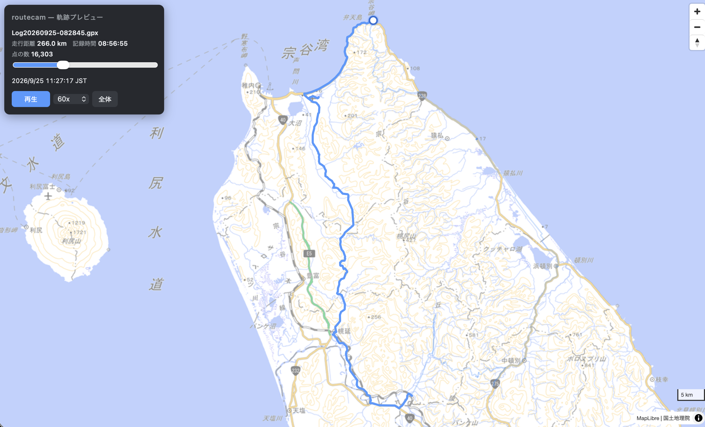

# routecam

スマホで記録したGPSログ（GPX）と、アクションカムで撮った動画を**撮影時刻で突き合わせて同期再生する**デスクトップアプリ。地図上を走る点と車載映像を並べて、ドライブ全体を振り返ることを目的としています。

GPSと映像が**別々の機材**で記録されている点が出発点です。既存のドラレコ用ソフトは映像に埋め込まれたGPSを読むものが中心で、この組み合わせに合うものが見当たらなかったため自作しています。

## 現在の状態

**フェーズ1（軌跡の表示とアニメーション）が動作します。** ビルド不要の静的HTML1枚（405行）で、依存はCDNのMapLibre GL JSのみです。



| | 実装状況 |
| --- | --- |
| **フェーズ1** 軌跡の表示・点のアニメーション・再生操作 | ✅ 完了 |
| **フェーズ2** 動画の読み込みと「動画→地図」の同期 | 未着手 |
| **フェーズ3** 「地図→動画」の同期・時刻ずれ補正・タイムライン | 未着手 |

### 動かす

```bash
git clone https://github.com/mymt2101/routecam.git
cd routecam
python3 -m http.server 8777   # file:// では fetch がブロックされるためHTTPで配る
open http://localhost:8777/index.html
```

`original/` のGPXを自動で読み込みます。再生ボタン（またはスペースキー）で点が動きます。

## 実装の要点

### 時刻から位置を求める

同期処理の心臓部です。GPXの点は1〜2秒おきにしか存在しないため、そのままでは点がカクカク飛びます。

1. **二分探索**で、現在時刻に該当する点を探す。16,303点でも14回程度の比較で見つかる
2. 前後2点のあいだを**線形補間**し、滑らかな座標を得る

この処理はフェーズ2の「動画の再生位置 → 地図上の点」にそのまま流用できる設計にしています。

### GPS欠損への対応

実データを調べたところ、**60秒以上の欠損が58箇所、最大は約23分**ありました。素朴に実装すると点が地図上をワープします。そのため欠損を検出して3箇所で効かせています。

- 全ルートの線を分割して描画する（`MultiLineString`）
- 欠損区間では補間せず、点を手前の位置に留める
- 走行距離に加算しない（経路が不明なため）

### 時刻を決める処理と、描く処理の分離

`cursor`（開始から何秒進んだか）という**1つの数値を唯一の正解**とし、`update()` がそこから地図・走行済みの線・シークバー・時刻表示をまとめて描きます。時刻を進める処理（`requestAnimationFrame` のループ）とは分離してあるため、

- 再生中 … ループが時刻を進める
- シークバー操作 … バーの位置から時刻を逆算する
- （フェーズ2）動画同期 … 動画の再生位置から時刻を求める

のどの経路でも `update()` を呼ぶだけで済み、描画側に手を入れる必要がありません。

### 描画の負荷対策

走行済みの線を毎フレーム16,303点ぶん作り直すと重くなるため、**進んだぶんだけ座標を継ぎ足し**、巻き戻された時のみ再構築しています。

## 技術選定

| 項目 | 選択 | 理由 |
| --- | --- | --- |
| 地図 | **MapLibre GL JS** 4.7.1 | OSSでAPIキー不要。タイルを自由に選べる（既存ソフトはGoogle Maps依存が多い） |
| 地図タイル | **国土地理院** 淡色地図 | キー不要で国内の道路表現が適切 |
| GPXの解析 | ブラウザ標準の **DOMParser** | GPXはXMLなので外部ライブラリ不要 |
| 距離計算 | Haversine 式 | 測地線距離。標高差は無視 |
| アニメーション | `requestAnimationFrame` | 画面の更新と同期し、フレーム落ち時も再生速度が狂わない |
| デスクトップ化 | **Tauri / Electron（未決）** | 下記のコーデック問題を先に解決する必要がある |

ブラウザで完結させてから、デスクトップアプリとして包む方針です。OS依存の処理（ファイル読み込み・動画メタデータ取得）を差し替えられるよう分離する予定です。

## 検証して分かったこと

手持ちの実データ（GPX 1本と動画1本）を調べ、設計上の前提を確定させました。詳細は [要件定義書](docs/01_要件定義.md) に記載しています。

| 項目 | 結果 |
| --- | --- |
| GPXサンプル | 16,303点 / 8時間57分 / **266.0 km**（北海道北部） |
| 動画 | DJI Osmo Action 4、**HEVC（H.265）10bit**、7分23秒で1.79GB |
| `creation_time` | **UTC**で記録。懸念していた9時間ずれは発生しない |
| 動画内のGPS | **なし**（GPS非搭載機）。GPXが必須であることが確定 |

### 最大の技術リスク：HEVC

手持ちの動画がHEVCの10bitであることが判明しました。**ブラウザはHEVCの再生機能を自前では持たず、OSのデコーダを借りて動きます**（特許ライセンスの都合）。そのため再生できるかは「ブラウザが何か」ではなく「OSにHEVCの機能が入っているか」で決まります。

- macOS … OS標準で対応、再生可
- Windows … 標準では非対応。ストアの拡張機能をユーザーが導入する必要がある
- 10bit … さらに対応状況が限られる

重要なのは、**Chromiumを同梱するElectronを選んでもこの問題は解決しない**ことです。同梱されるのはChromium本体のみで、HEVCの再生機能は依然OS側に依存するためです。Electronの「挙動が揃う」という利点がHEVCには効きません。

したがって **Tauri / Electron の選択より先に、HEVCの扱いを決める必要がある**と判断しました。当面は「今後の撮影をH.264に切り替える」「Windowsでは拡張機能を前提とする」を基本線とし、必要に応じて取り込み時のH.264変換を検討します。

## リポジトリ構成

```
index.html              フェーズ1の実装（単一ファイル・ビルド不要）
docs/01_要件定義.md      要件・技術選定・競合調査・リスク整理
docs/screenshot.png     動作画面
original/               サンプルGPX（動画は容量のため非管理）
```

動画は1本で数GB、1日分で数十GBになりGitHubの100MB制限を超えるため、`.gitignore` で除外しています。

## 次の作業

1. **HEVC 10bitの動画が `<video>` で再生できるかの確認**（最優先。結果によりフェーズ2の設計が変わる）
2. Vite化とOS依存処理のモジュール分離
3. フェーズ2：動画の読み込みと「動画→地図」の同期
